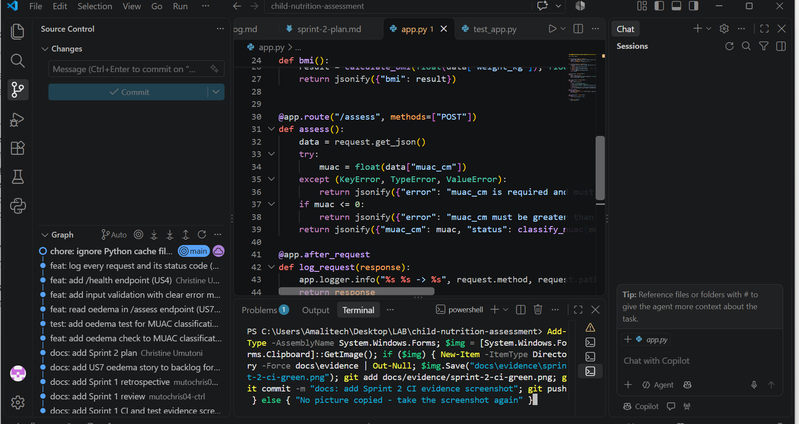

# Sprint 2 Review

## Sprint Goal
Make the nutrition service safer and more reliable: detect oedema, give clear error messages, and make the service easy to monitor.

## Completed Stories

| ID | Story | Status |
|----|-------|--------|
| US7 | Record bilateral oedema so severe malnutrition is not missed | Done |
| US3 | Clear error messages for wrong or missing values | Done |
| US4 | Health check endpoint (/health) | Done |
| US5 | Log requests and status codes | Done |

**Completed: 7 of 7 points**

**Velocity:** Sprint 1 = 6 points, Sprint 2 = 7 points. All planned work was finished in both sprints.

## Definition of Done Check

| DoD item | US7 | US3 | US4 | US5 |
|----------|-----|-----|-----|-----|
| Code pushed to main | Yes | Yes | Yes | Yes |
| Acceptance criteria met | Yes | Yes (age check moved to US8) | Yes | Yes |
| Automated pytest tests | Yes | Yes | Yes | Yes |
| CI green | Yes | Yes | Yes | Yes |
| Code readable with comments | Yes | Yes | Yes | Yes |
| README updated | Yes | Yes | Yes | Yes |
| Shown in Sprint Review | Yes | Yes | Yes | Yes |

## Extra fixes after review feedback
- Bug found: `"oedema": "false"` (text) was read as true, so a healthy child could be marked severe. Fixed: oedema must be true or false, otherwise HTTP 400. Two tests added.
- Logging improved to fully meet US5: every log line now has the time, each assessment result is logged, and invalid requests are logged as WARNING. Two tests added.

## Evidence
- 16 automated tests pass (pytest): see [evidence/sprint-2-test-results.txt](evidence/sprint-2-test-results.txt)
- Monitoring: example console logs with time, INFO and WARNING lines: see [evidence/sprint-2-logs.txt](evidence/sprint-2-logs.txt)
- CI (GitHub Actions) is green for every Sprint 2 commit: see [evidence/sprint-2-ci-green.png](evidence/sprint-2-ci-green.png)
- Small, step-by-step commits for each change
- README updated with run, test and endpoint instructions

## Demo
- POST /assess with oedema true returns Severe Acute Malnutrition
- POST /assess with a missing or wrong muac_cm returns a clear error (400)
- GET /health returns status ok
- POST /assess with `"oedema": "false"` (text) returns a clear error (400)

Example log output:

```
2026-10-12 08:27:06,058 INFO Assessment: muac_cm=11.0 oedema=False -> Severe Acute Malnutrition
2026-10-12 08:27:06,060 INFO POST /assess -> 200
2026-10-12 08:27:06,069 WARNING POST /assess -> 400
```


